# Hi, I'm Anita George 👋

I’m a passionate Computer Science student at IIIT Kottayam with a strong foundation in frontend development and UI/UX. I love crafting seamless, user-friendly web experiences that blend creativity with technical expertise. Currently, I’m exploring the intersection of design and development—diving into modern frameworks, user psychology, and emerging technologies. I believe great design isn’t just about aesthetics but about functionality, ensuring every project bridges user needs with innovation.

### ✨ Fun Fact:
I'm a passionate frontend developer and UI/UX enthusiast studying at the Indian Institute of Information Technology, Kottayam! When I'm not coding, you can find me sketching design wireframes or exploring new web technologies!

---

### 🚀 Skills & Technologies:
                

---

### 💡 What I love to do:

  

---

### 🎨 Paint my wall:

<!-- canvas:start -->

<b>Paint a pixel on my wall.</b> Click any square, pick a colour, submit. Your pixel appears here in about 30 seconds, signed with your name.

 
 
 
 
 
 
 
 
 

<b>2</b> pixels painted by <b>1</b> person · latest: <a href="https://github.com/AnitaGeorge404">AnitaGeorge404</a> → L6 · <a href="https://github.com/AnitaGeorge404/AnitaGeorge404/issues?q=label%3Acanvas">history</a>

<!-- canvas:end -->

---

### 🪨 My Strata:

<picture>
  <source media="(prefers-color-scheme: dark)" srcset="strata/strata-dark.svg">
  
</picture>

Every layer is a month of code, coloured by the language I used most. Redrawn nightly by <a href="https://github.com/AnitaGeorge404/strata">Strata</a>.

---

### 🌌 My Sky:

<picture>
  <source media="(prefers-color-scheme: dark)" srcset="constellate/constellate-dark.svg">
  
</picture>

Every repo is a star, and every language a constellation. The moon follows my streak. Charted nightly by <a href="https://github.com/AnitaGeorge404/constellate">Constellate</a>.

---

### 📈 GitHub Stats:

---

### 🎓 Education & Experience

**Indian Institute of Information Technology, Kottayam**
- Pursuing B.Tech in Computer Science Engineering
- Focusing on Frontend Development and UI/UX Design
- Active participant in various coding competitions and hackathons
- Member of the college's technical club, contributing to web development projects

---

### 🌐 Connect with Me:

   

---
